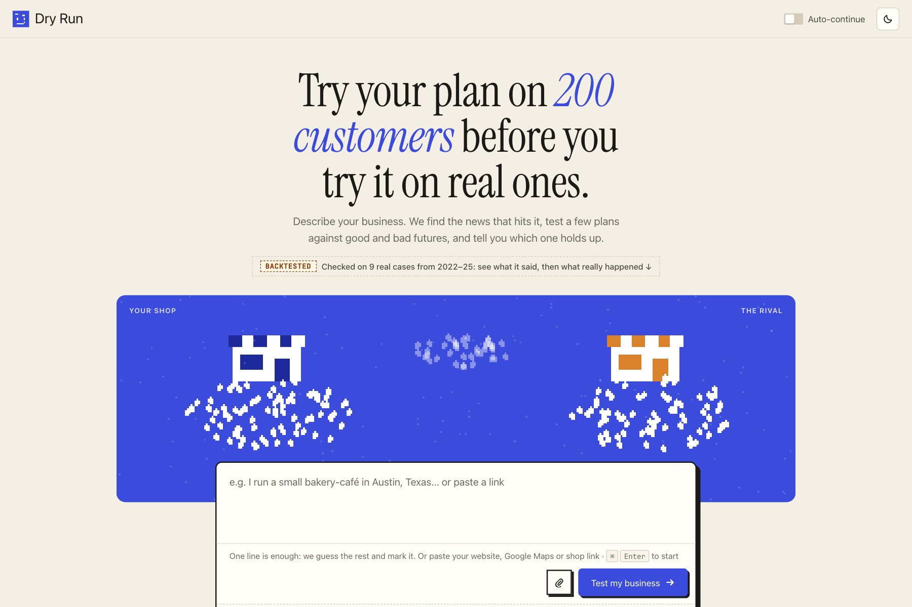
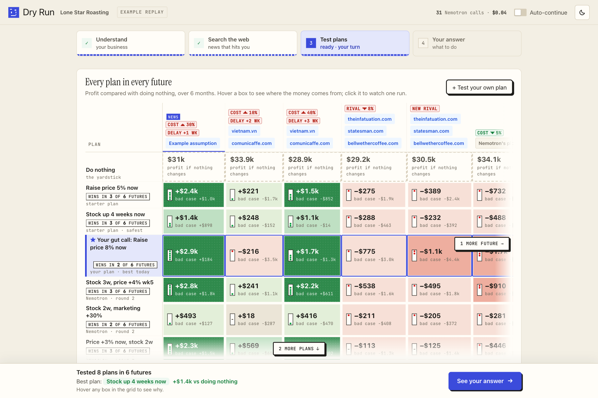
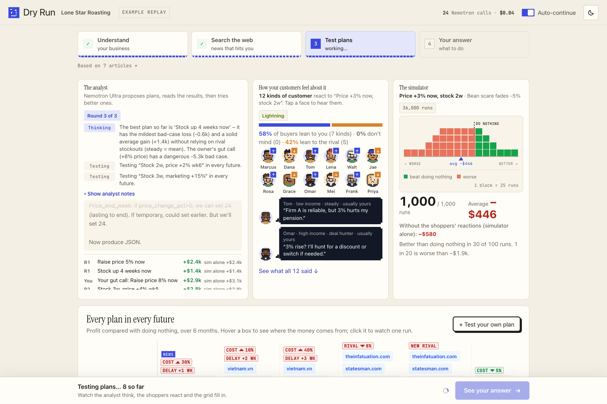
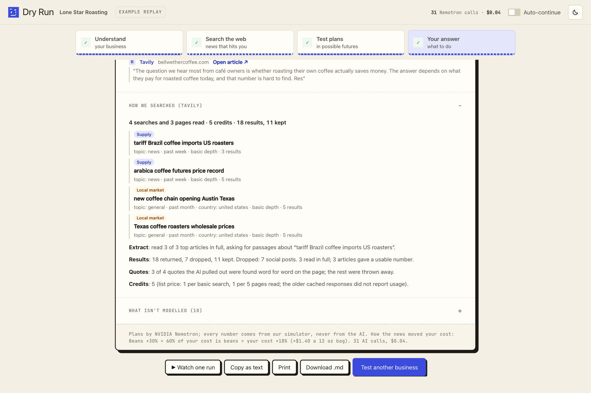
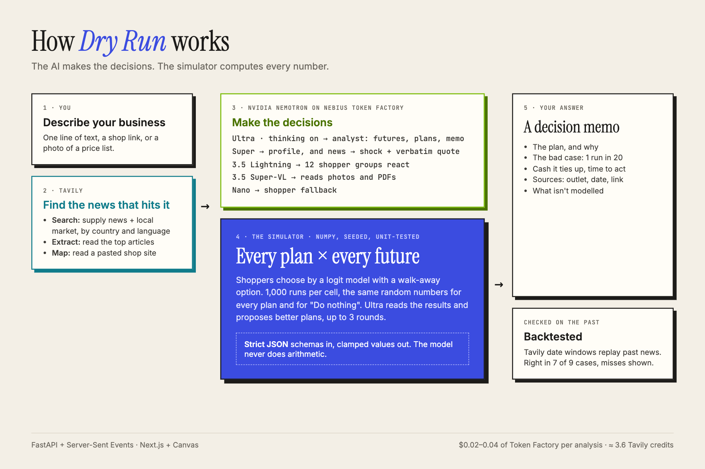

# Dry Run

**Test your plans before you bet the shop on them.**

Describe your business in one line. Tavily finds the news that hits it, **NVIDIA Nemotron** (served by **Nebius Token Factory**) proposes plans, and a deterministic simulator tests every plan in several futures. You get a decision memo with its sources and an honest list of what it doesn't model.

**Live demo:** https://dryrun-1hny.onrender.com · Built for the Nebius x NVIDIA Global AI Hackathon (Best Apps and Agents) · MIT license



## For judges: try it in one minute

1. Open https://dryrun-1hny.onrender.com. The free host can take about 50 seconds to wake up.
2. Pick an example, such as **Coffee roaster in Austin, Texas**. It replays a run recorded live with Nemotron, so it is free and always works.
3. Press **"Check live news"** to make a real Tavily call. Scroll the landing page to **"We tested it on the past"** for the backtests, misses included.
4. Type your own business to run it live. Live runs are rate-limited and have a daily spend cap.

## What it does

| Step | What happens | Who does it |
|---|---|---|
| 1. Understand | Turns your words (or a shop link, or a photo of a price list) into a business profile | Nemotron 3 Super, Nemotron 3.5 Super-VL, Tavily Extract/Map |
| 2. Search the web | Finds supply news and local-market news in your country's language, reads the articles, and turns each into a cost or demand shock backed by a quote found word for word on the page | Tavily Search + Extract, Nemotron 3 Super |
| 3. Test plans | An analyst picks 2–6 futures and proposes plans over up to 3 rounds. 12 groups of shoppers react to each plan. A NumPy engine runs 1,000 simulated futures per plan × future, against "Do nothing" | Nemotron 3 Ultra, Nemotron 3.5 Lightning, NumPy engine |
| 4. Your answer | A decision memo: the plan, the bad case (1 run in 20), the cash it ties up, the time to act, the sources, and what isn't modelled | Nemotron 3 Ultra (words), engine (every number) |

**The rule that makes it trustworthy:** the models make *decisions* (plans, shopper reactions, shock sizes). The engine computes every *outcome* (demand, revenue, profit, statistics). No model ever does arithmetic.



## How we use NVIDIA Nemotron

Every model call in Dry Run goes to an NVIDIA Nemotron model. Each model gets the job its size suits.

| Model (Token Factory ID) | Thinking | Job in Dry Run | Why this size | Measured |
|---|---|---|---|---|
| **Nemotron 3 Ultra** `nvidia/Nemotron-3-Ultra-550b-a55b` | on | **The analyst.** Picks the futures to test (news shock levels, a rival's price move, a new player). Proposes plans, reads the engine's results, and proposes better ones over up to 3 rounds. Can ask Tavily its own question mid-analysis. Writes the memo. | A few calls where deep reasoning is worth the wait | Answer at ≈ 8.5 s, ≈ 340 tok/s. One analysis = 4 Ultra calls ≈ $0.014 |
| **Nemotron 3 Super** `nvidia/nemotron-3-super-120b-a12b` | off | **The reader.** Turns plain text into a business profile, and an article into a shock with a verbatim quote | Strict-schema extraction, where speed matters more than reasoning | 1.2–2.0 s and ≈ $0.0003 per profile |
| **Nemotron 3.5 Lightning** `nvidia/Nemotron-3_5-Lightning` | off | **The shoppers.** 12 kinds of customer each say how they feel about a plan (sentiment mean and spread), shown as pixel faces with a speech bubble | Many small parallel calls | 0.94 s TTFT, 198 tok/s |
| **Nemotron 3 Nano** `nvidia/NVIDIA-Nemotron-3-Nano-30B-A3B` | off | Shopper fallback | Kept as backup | 5.2 s TTFT, which is why Lightning is primary |
| **Nemotron 3.5 Super-VL** `nvidia/Nemotron-3.5-Super-VL` | off | Reads an uploaded photo or PDF (a price list, a sales report) into the profile | Vision, same API | 1.6 s for a 600×400 image |

How we call them (see `backend/agents/` and `backend/services/router.py`):

- **Out of the box, no fine-tuning.** We rely on prompt and system engineering, and the numbers come from the engine, not the model weights.
- **Strict `json_schema` on every call,** validated with Pydantic v2 and clamped. Each call retries once, then uses a deterministic fallback. Timeouts are per tier: Ultra 30 s, Super 10 s, Lightning 5 s.
- **Thinking is switched per model** with `chat_template_kwargs`. Ultra's reasoning streams in `reasoning_content` and appears in the UI's analyst notes, while `content` stays clean JSON.
- **A per-model rate limiter** reads the `x-ratelimit-*` headers, honours 429 `Retry-After`, and drops shopper calls first.
- **Every telemetry figure in the UI** (Nemotron calls, $ spent) is counted from real call logs.

Shoppers choose with a multinomial logit model that includes a walk-away option. Lightning supplies the sentiment term; the engine supplies the rest:

$$\Pr_{ij} = \frac{e^{\bar U_{ij}}}{e^{\bar U_{i0}} + \sum_{k\in\{A,B\}} e^{\bar U_{ik}}},\qquad U_{ij} = \beta_{0j} - \alpha_i P_j + \gamma\ln(1+M_j) + \delta\,\text{Sent}_{ij} + \text{loyalty}_{k(i),j}$$



## Where Nebius Token Factory accelerated our workflow

- **Day 1 took one script and $0.008.** One API key and one OpenAI-compatible client (`openai` SDK, `base_url` from an env var) reached every Nemotron model. We checked model IDs, the thinking toggle, the reasoning field, latency and rate limits for all of them in a single run (`bench/results/day1_check_*.json`).
- **Swapping a model is one env var** (`MODEL_ULTRA`, `MODEL_SUPER`, `MODEL_FAST`, …). That made comparing Lightning against Nano a same-day decision, and adding vision (Super-VL) took no new client code.
- **Reasoning arrives apart from the answer.** `reasoning_content` comes separately from `content`, so strict JSON keeps working with Ultra's thinking on. We stream that reasoning straight into the UI.
- **Rate-limit headers made a multi-agent loop safe.** A per-model limiter built on `x-ratelimit-*` runs about 45 requests a minute across 4 models without tripping limits.
- **Clear error bodies.** HTTP 402 `credit_balance_exhausted` and 401 `unauthenticated` drive an in-app notice that stops a live run on the first dead call.
- **It is cheap enough to test honestly.** A full live analysis costs $0.02–0.04 in total (Ultra, Super and Lightning calls together; the recorded Austin run made 31 Nemotron calls for $0.04). Re-recording all 10 backtest cases cost under $1, so we could re-run them every time we changed the model.
- **No GPUs to manage.** We self-host nothing; every token comes from Token Factory.

Everything we hit along the way, good and bad, with evidence, is logged in [`docs/FEEDBACK_LOG.md`](docs/FEEDBACK_LOG.md).

## Other Nebius tools and services

- **Nebius Token Factory:** all model inference, as above.
- **Nebius Serverless Jobs:** `backend/services/nebius_jobs.py` and `jobs/mc_worker` package the 10,000-run verification of the chosen plan as a job submitted through the Nebius CLI (`JOB_BACKEND=nebius`). In this submission the job runs in-process on the host (`JOB_BACKEND=local`). We did not run it on Nebius, so we don't claim it.
- **Hosting:** the public demo runs on Render's free tier. Keeping a Nebius endpoint up until judging ends (Dec 15) would have cost an estimated $90–195, and Token Factory credit was the better use of the budget.

## How we use Tavily

Tavily is called at runtime in every analysis (`backend/services/tavily_scout.py`):

- **Search** finds supply news (`topic: news`, past week) and local-market news (`topic: general`, `country`, local-language queries, `exact_match` on a rival's name). Backtests use `start_date`/`end_date` so a past case can't read later news.
- **Extract** with `query` reads the top articles. A number only reaches the engine if its quote is found word for word in the extracted text.
- **Map** with `select_paths` finds a shop's menu or price pages when a pasted link is thin.
- **Nemotron Ultra can ask Tavily one more question per round** (at most 2 per analysis). A real change it finds becomes a new future that every plan is tested in.
- **The memo shows the work.** Each source reads "Tavily · outlet · date · link", and a "How we searched" panel lists every query, its credits (`include_usage`), and what was dropped and why.

From our logs: about **3.6 credits per analysis**, **18.8%** of results dropped before reading (social posts, out-of-window dates), and **24 of 37** articles read gave a verified number.



## Backtested, misses included

We replay past cases with only the news available before each date, then score the advice against what really happened. The app lists every case: **right in 7 of 9**, with the misses explained (details: [`docs/BACKTEST_HELDOUT.md`](docs/BACKTEST_HELDOUT.md)).

**Caveat:** Nemotron Ultra's training data covers these years, so the model may already "know" a past price spike. The Tavily date window keeps the *news* blind; it can't make the model forget.

## Architecture



- **Backend:** Python 3.11+, FastAPI with Server-Sent Events, Pydantic v2, NumPy/SciPy. `backend/engine/` is pure, seeded and unit-tested, with no I/O. `backend/agents/` holds the Nemotron roles, and `backend/services/` holds the router, the limiter, Tavily, replay and telemetry.
- **Frontend:** Next.js 14, TypeScript, Tailwind, Zustand, and an HTML5 Canvas pixel arena (`frontend/`).
- **Replay mode** (the public default) streams a recorded live run from `fixtures/replays/`, so the demo works with no keys and costs nothing.

## Setup

**Requirements:** Python 3.11+ with [uv](https://docs.astral.sh/uv/), and Node.js 20+ with npm.

```bash
git clone https://github.com/dothanhchuong123-blip/dryrun.git
cd dryrun
```

### 1. Offline demo: no keys, free

```bash
./dev.sh
```

Open http://localhost:3000 and pick an example. It replays a recorded run in the browser.

### 2. Live mode: real Nemotron and Tavily calls

```bash
cp .env.example .env
```

In `.env`, set `NEBIUS_API_KEY` (from [Nebius Token Factory](https://tokenfactory.nebius.com)) and `TAVILY_API_KEY` (from [tavily.com](https://tavily.com)). The model IDs and base URL are already filled in and are case-sensitive. Then run:

```bash
./dev.sh --live
```

This starts the backend on :8000 and the frontend on :3000. A live run costs a few cents of Token Factory credit, capped by `DAILY_SPEND_CAP_USD`. Set `LIVE_ENABLED=false` to turn off every paid call; replays keep working.

### 3. Tests and lint

```bash
uv sync
uv run pytest -q
uv run ruff check backend tests
```

### 4. Deploy

The `Dockerfile` builds the static frontend and the Python app into one image. `render.yaml` is a one-click Render Blueprint: add `NEBIUS_API_KEY` and `TAVILY_API_KEY` as secrets in the dashboard. Details: [`docs/DEPLOY.md`](docs/DEPLOY.md).

### Environment variables

| Variable | Purpose |
|---|---|
| `NEBIUS_API_KEY`, `NEBIUS_BASE_URL` | Token Factory key and OpenAI-compatible base URL |
| `MODEL_ULTRA`, `MODEL_SUPER`, `MODEL_FAST`, `MODEL_FAST_FALLBACK`, `MODEL_VISION` | Nemotron model IDs, one per role |
| `TAVILY_API_KEY`, `TAVILY_DAILY_CREDIT_CAP` | Tavily key and daily credit cap for public buttons |
| `DAILY_SPEND_CAP_USD`, `PUBLIC_LIVE_DAILY_CAP_USD`, `LIVE_ENABLED` | Spend guards and kill switch |
| `JOB_BACKEND` | Where the 10,000-run verification runs: empty (off), `local`, or `nebius` |

## What it doesn't model

Every memo ends with its own list. In general, Dry Run models one product, one rival and 200 simulated customers over 6 months. It doesn't know your real sales history, and the shopper reactions are a model's guesses, so we keep their weight low and show "simulator alone" next to every number.

## License

[MIT](LICENSE) © 2026 Chuong Do
